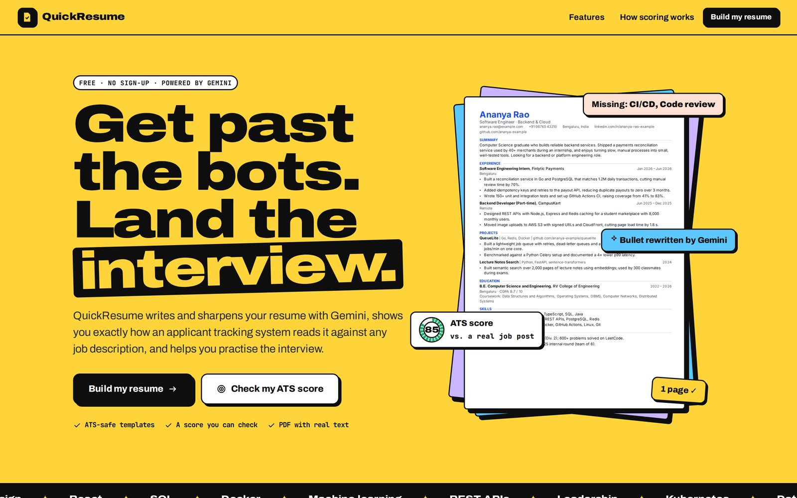
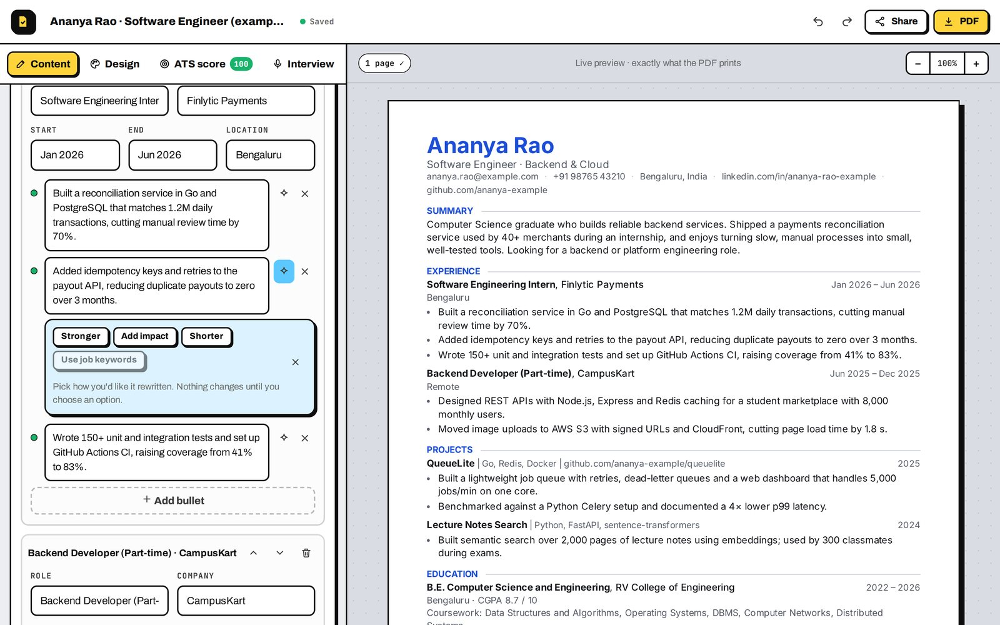
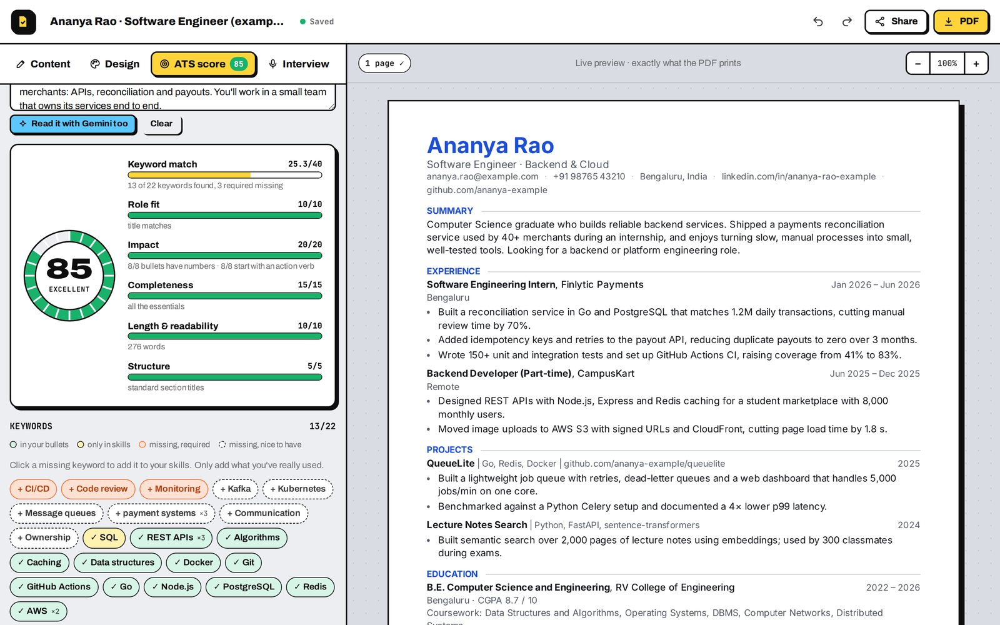
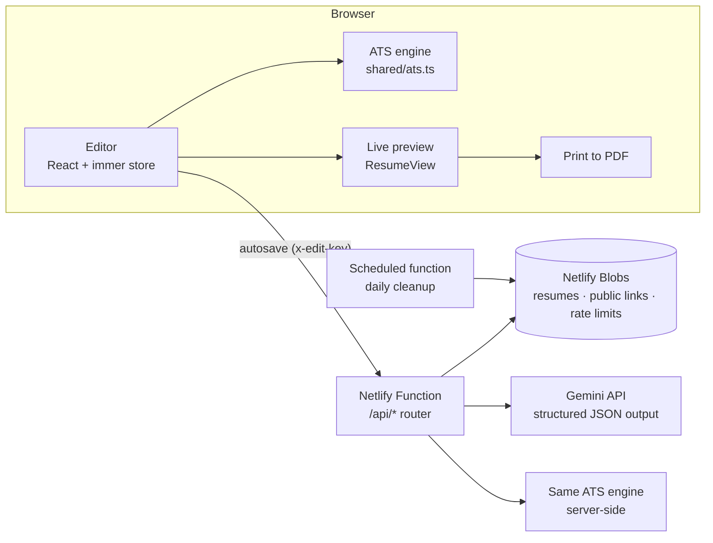

# QuickResume

**An AI resume builder that shows its work.** Gemini drafts and sharpens your resume, a live preview shows exactly what the PDF will look like, and a transparent ATS score tells you how the resume reads against any job description: which keywords are missing, which bullets have no numbers, and what to fix first. Then practise the interview with questions written for your resume.

**Live:** https://quickresume-nishant.netlify.app &nbsp;·&nbsp; **Author:** [Nishant Singh](https://nishant-singhaa0240274.netlify.app)



## Features

**Write**
- **Import** an existing resume (PDF, image or pasted text). Gemini reads it into structured, editable sections and keeps your wording.
- **Draft from notes:** rough notes about your education, internships and projects become a complete first draft.
- **One-click rewrites** for any bullet: stronger, add impact, shorter, or use the job's keywords. You pick from three options.
- **No invented facts:** the AI is told never to make up employers, tools or numbers. Where a metric would help, it leaves a highlighted `[placeholder]`, and the ATS check reminds you to fill it in.
- A live **bullet checker** (green, amber or orange dot) flags weak openers like "Responsible for…" and bullets without a measurable result.

**Check**
- **ATS score out of 100**, recomputed as you type, with a breakdown: keyword match (40), impact (20), completeness (15), role fit (10), length and readability (10), structure (5).
- **Keywords** from the job description, split into must-haves and nice-to-haves, and marked as found in your bullets, only in your skills list, or missing. Gemini can read the job description too and add keywords the built-in dictionary doesn't know.
- **Prioritised tips**: click one to jump to the exact bullet.
- **Tailor to this job:** Gemini suggests a new summary and rewrites of the bullets that match the job. You accept each change, and every change can be undone.

**Present**
- Three **ATS-safe templates** (Modern, Classic, Technical): single column, real text, standard headings, accent colours, text size and spacing controls, A4 or US Letter.
- **PDF download** through the browser's print engine. The output was checked with `pdftotext`: selectable text, embedded TrueType fonts and one page for the example resume.
- **Public link** (`/r/your-name-xxxx`) with a view counter, **private edit link** to continue on another device, plain-text copy for job portals, and JSON backup.

**Practise**
- **Interview questions** written for your resume and the job: technical, project deep-dives, role scenarios and behavioural.
- Type an answer and get a **score out of 10**, what worked, what to improve and a stronger version.
- Works without AI too, using a built-in bank of questions matched to your skills.





## How the ATS score works

The score is deterministic TypeScript in `shared/ats.ts`. It runs in the browser on every keystroke and on the server through `POST /api/ats`.

1. **Reading the job description.** A dictionary of over 200 skills with their common spellings (`shared/skills.ts`) finds keywords such as "Node.js / nodejs / node js". Words that are also plain English only count when they look like the skill, so "react quickly" is not React and "go-live" is not Go. Lines under "Nice to have" or "Preferred" headings make a keyword optional. Soft skills weigh less. Repeated two-word phrases catch domain terms ("payment systems"). The job title, years of experience and degree are extracted too.
2. **Scoring the resume.** A keyword found in a bullet or the summary earns full credit. One found only in the skills list earns 75%, because recruiters look for proof. Bullets are checked for an action verb and a number. The remaining parts check contact details, length (one page for early-career resumes) and standard section headings.
3. **Tips** are generated from the gaps and sorted by impact.

The engine has its own unit tests (`npm test`).

## Architecture



| Layer | Technology |
|---|---|
| Frontend | React 18, **TypeScript**, Vite, React Router, Framer Motion, immer (undo/redo) |
| Backend | Netlify Functions (TypeScript, Node 22): one router, plus a daily scheduled cleanup |
| Database | Netlify Blobs: resumes, public links (claimed with `onlyIfNew`), view counts and rate limits |
| AI | Gemini API with JSON schemas, PDF/image input, a model fallback chain and per-IP limits |
| Shared code | `shared/`: the resume model, validation, the ATS engine, skills dictionary and question bank, used by both browser and server |

**Privacy by design:** there are no accounts. Creating a resume returns a random edit key that stays in your browser (only its SHA-256 hash is stored). The private edit link carries the key in the URL fragment (`#k=…`), which browsers never send to servers. Job descriptions stay in your browser. Resumes that are never shared and not edited for 180 days are deleted by the cleanup job.

## API

| Method | Path | Description |
|---|---|---|
| `POST` | `/api/resumes` | Create a resume → `{ id, key }` |
| `GET` / `PUT` / `DELETE` | `/api/resumes/:id` | Read, save or delete (header `x-edit-key`) |
| `POST` | `/api/resumes/list` | Titles and dates for the resumes this browser has keys for |
| `POST` / `DELETE` | `/api/resumes/:id/publish` | Create or remove the public link |
| `GET` | `/api/public/:slug` | A shared resume (counts one view per visitor every 6 hours) |
| `POST` | `/api/ats` | `{ resume, jd, ai? }` → score, parts, keywords and tips |
| `POST` | `/api/ai/import` | `{ text }` or `{ file: { mimeType, data } }` → structured resume |
| `POST` | `/api/ai/draft` | Notes → first draft |
| `POST` | `/api/ai/bullet` | `{ text, mode: improve \| quantify \| shorten \| keywords }` → 3 options |
| `POST` | `/api/ai/summary` · `/api/ai/keywords` · `/api/ai/tailor` | Summary options, job keywords, tailoring suggestions |
| `POST` | `/api/ai/interview` · `/api/ai/feedback` | Questions (AI or built-in bank) and answer feedback |
| `GET` | `/api/health` | Status and configuration |

## Run it locally

```bash
npm install
npm install -g netlify-cli
netlify dev              # app + API + local Blobs at http://localhost:8888
```

Optional: put `GEMINI_API_KEY=...` in a `.env` file to turn on the AI features. Without it, everything else works: the editor, templates, PDF, ATS score and the built-in interview questions.

Tests:

```bash
npm test                  # ATS engine unit tests (Node 22)
npm run typecheck         # TypeScript, strict mode
python3 tests/api_test.py # 30 end-to-end API checks (needs netlify dev running)
```

## Deploy (Netlify free plan)

1. Push this folder to a GitHub repository named `quickresume`.
2. Netlify → **Add new project → Import an existing project → GitHub** → pick `quickresume`. Build settings come from `netlify.toml`.
3. Before deploying, add the environment variable `GEMINI_API_KEY` and mark it as a secret. Optional: `GEMINI_MODEL`, a model to try before the built-in list.
4. Name the project `quickresume-nishant`, deploy, then click **Make public**.

## Project structure

```
shared/types.ts        the resume model
shared/normalize.ts    validates any incoming JSON into a safe Resume
shared/ats.ts          job-description analysis and scoring
shared/skills.ts       skills dictionary with spellings and case rules
shared/verbs.ts        action verbs, weak openers, bullet checks
shared/questions.ts    built-in interview question bank
netlify/functions/     api.mts (router), cleanup.mts (daily)
netlify/lib/           Blobs storage, Gemini client, prompts, HTTP helpers
src/pages/             Landing, Start, Editor, PublicResume
src/editor/            Content, Design, ATS and Interview panels
src/resume/            the three templates, preview and pagination
tests/                 ATS unit tests, API tests
```

## License

MIT © Nishant Singh
